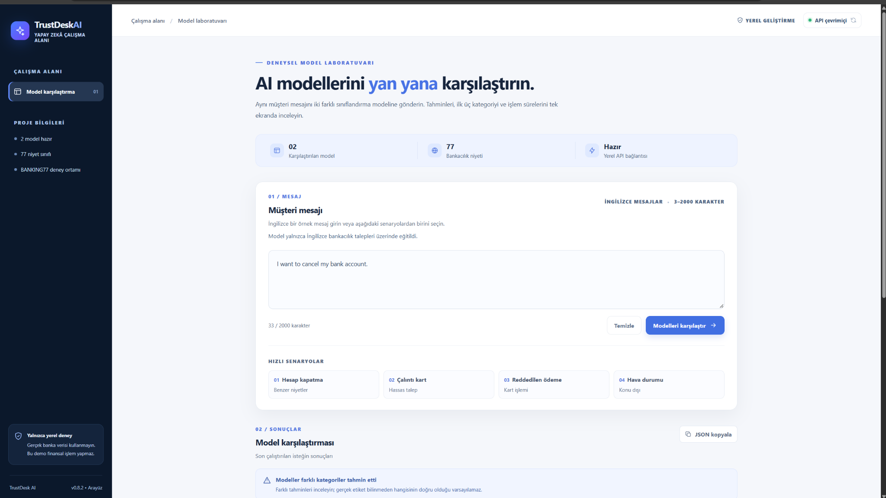
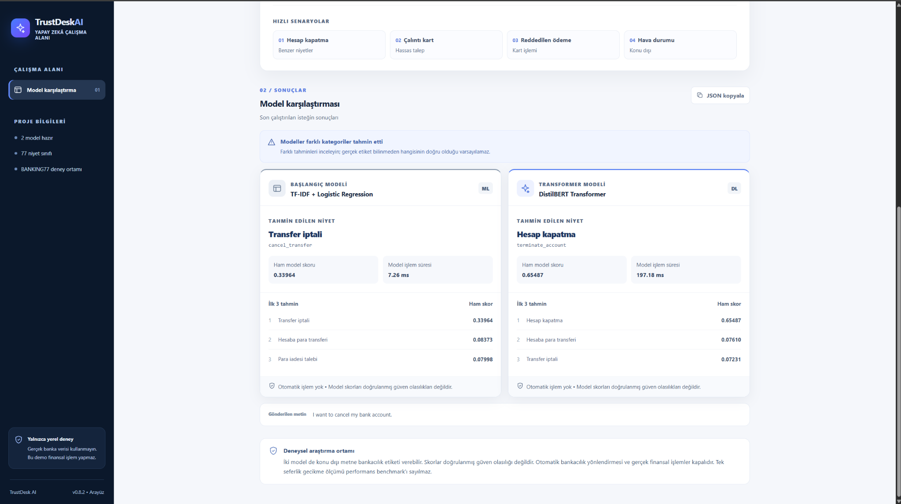
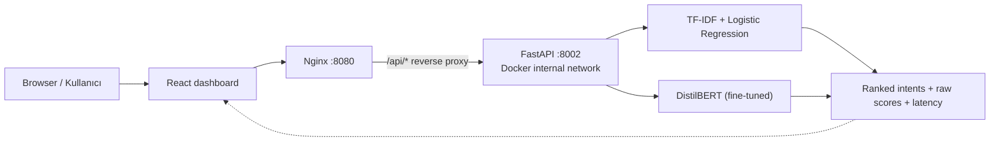

# TrustDesk AI

**Evidence-driven banking intent classification · DistilBERT vs. TF-IDF · FastAPI · React · Docker**


TrustDesk AI is a **local research and portfolio demo** that compares two NLP approaches on **77 English banking support intents** from [PolyAI BANKING77](https://github.com/PolyAI-LDN/task-specific-datasets/tree/master/banking_data). A React dashboard sends the same message to TF-IDF + Logistic Regression and a fine-tuned DistilBERT model, then displays their ranked predictions and inference times.

**Türkçe özet:** TrustDesk AI, BANKING77 veri kümesinde iki farklı niyet sınıflandırma modelini aynı mesaj üzerinde karşılaştıran, FastAPI + React + Docker Compose ile yerelde çalışan deneysel bir uygulamadır.

> [!IMPORTANT]
> **Research demo only — not production banking software.** Do not enter real customer data. Models may misclassify messages or force out-of-domain content into one of 77 categories. Raw scores are **not verified calibrated confidence probabilities**. Automatic routing and banking transactions are disabled. No publicly hosted app is provided.

## Screenshots / Ekran görüntüleri

**Model Lab — English customer message and ready-to-use scenarios (React v0.8.2):**



**Side-by-side results — sample message “I want to cancel my bank account.”:**



*These are actual screenshots from a local React development session (`127.0.0.1:5173`), not a hosted live service. The sample illustrates model disagreement; it is not a benchmark of general performance.*

## Features / Özellikler

- **77-class English intent classification** with a TF-IDF + Logistic Regression baseline and a four-epoch fine-tuned DistilBERT.
- **Comparison dashboard:** top-3 predicted intents, translated **UI labels** with original English intent codes, raw model scores and model execution times.
- **FastAPI endpoints:** `GET /health`, `GET /v1/models`, `POST /v1/predict`, `POST /v1/compare`.
- **Local Docker Compose:** React built with Vite, served by Nginx on `127.0.0.1:8080`; FastAPI accessible inside the Compose network, using CPU inference.
- **Quality assurance:** API contract/input tests, React tests, validation experiments, local sequential latency measurements, and successful GitHub Actions Python/React jobs.
- **Safety boundaries:** 3–2,000-character API input validation, no financial actions or automatic routing, documented deployment limitations.

## Architecture / Mimari



The backend reads model checkpoints from a **read-only local** `artifacts/` bind mount. The Docker images, this repository and GitHub Actions **do not contain or download model weights**. In development (without Docker), React uses `127.0.0.1:5173` and FastAPI uses `127.0.0.1:8002`.

## Evaluation / Değerlendirme

**Exploratory validation**, not an independent final test evaluation:

| Model | Validation accuracy | Macro-F1 | Notes |
|---|---:|---:|---|
| TF-IDF + Logistic Regression | **83.36%** | Not reported here | Refit on the same 6,401-example training subset used in the comparison |
| DistilBERT, 4 epochs | **89.06%** | **0.89034** | 2,001-example validation; 219 classification errors |

DistilBERT scored approximately **5.70 percentage points** higher on this validation comparison. Results do not prove production accuracy, fairness, domain generalization or calibrated confidence. The default TF-IDF checkpoint loaded by the local API may differ from the baseline refit for the research comparison. Full caveats: [Model Card](docs/MODEL_CARD.md).

**Local development API latency**, 3 warm-up requests + 20 sequential measured requests per model (single machine, GPU-enabled local API; **not** Docker CPU):

| Latency | TF-IDF | DistilBERT |
|---|---:|---:|
| HTTP round-trip p50 | 12.152 ms | 17.771 ms |
| HTTP round-trip p95 | 20.129 ms | 31.778 ms |
| Model inference p50 | 0.473 ms | 10.313 ms |
| Model inference p95 | 0.763 ms | 14.478 ms |

These are exploratory measurements, not a concurrency/load test or SLA. The original local report is kept outside Git in `artifacts/qa_v09/report.json`.

## Quick start: tests without model weights

You can **clone the source and run automated tests without the trained checkpoint files**. Prerequisites: Python 3.11 and Node.js 24; commands below use Windows PowerShell from the repository root.

```powershell
git clone https://github.com/fathylmaz/trustdesk-ai.git
cd trustdesk-ai
py -3.11 -m venv .venv
.\.venv\Scripts\python.exe -m pip install -e ".[dev]" transformers==4.57.6 safetensors==0.8.0
.\.venv\Scripts\python.exe -m pytest -q
cd frontend
npm.cmd ci
npm.cmd run test
npm.cmd run build
```

A full interactive demo additionally requires **trusted locally generated model checkpoints** (see below). The repository does not ship pretrained/fine-tuned weights.

## Run the full local Docker demo / Docker ile çalıştırma

**Prerequisites:** Docker Desktop with Linux Engine/WSL2, CPU-capable Docker installation, and the model artifacts shown below. The initial CPU image can take considerable time to build.

```text
artifacts/
  baseline.joblib
  transformer_benchmark_4epochs/
    distilbert_model/
      config.json
      model.safetensors
      tokenizer.json
      ... other tokenizer metadata
```

Do not load untrusted `.joblib`/pickle files. The `artifacts` tree is ignored by Git; the container mounts it read-only. Checkpoints need to be produced/obtained separately from a trusted source: source code alone cannot immediately serve predictions. Training scripts are included, but **complete end-to-end experiment reproducibility has not been independently verified**.

```powershell
# In the repository root, once the model files exist:
.\.venv\Scripts\python.exe .\scripts\check_deploy_inputs.py
docker compose -f compose.yaml config --quiet
docker compose -f compose.yaml up --build
```

Open **http://127.0.0.1:8080/**. In another PowerShell terminal:

```powershell
docker compose -f compose.yaml ps
Invoke-RestMethod http://127.0.0.1:8080/api/health | Format-List *
```

For the verified local CPU deployment, the response included `status: ok`, `models_loaded: True`, `device: cpu`, `automatic_routing_enabled: False`. To stop the stack, run `docker compose -f compose.yaml down` in a separate terminal, or press Ctrl+C in the attached session. **Do not expose this development stack to the internet.**

### Developer mode without Docker

With Python/Node dependencies and **both trusted local model artifacts** already present:

```powershell
# Terminal 1, repo root
.\.venv\Scripts\python.exe -m uvicorn trustdesk_unified_api_v06:app --host 127.0.0.1 --port 8002

# Terminal 2
cd frontend
npm.cmd ci
npm.cmd run dev
```

UI: `http://127.0.0.1:5173/` · Swagger: `http://127.0.0.1:8002/docs`.

```powershell
$body = @{ text = 'I want to cancel my bank account.' } | ConvertTo-Json
Invoke-RestMethod -Method Post -Uri 'http://127.0.0.1:8002/v1/compare' -ContentType 'application/json' -Body $body
```

## Testing and CI

- **Local tests (reported):** 66 Python tests, 22 React tests and a successful Vite production build. A Windows security policy temporarily blocked a scikit-learn DLL during one pytest collection; retry passed.
- **GitHub Actions:** Both `python-tests` and `react-tests-and-build` completed successfully for commit `414e5ae`. [View the verified workflow run](https://github.com/fathylmaz/trustdesk-ai/actions/runs/39398907454).
- **CI scope:** tests and static build only; no model checkpoint downloads, Docker integration build, GPU benchmark, production security audit or final independent evaluation in CI.

The local live API QA tool requires the running backend on port 8002:

```powershell
.\.venv\Scripts\python.exe .\trustdesk_qa_v09.py --runs 20 --warmup 3
```

## Project layout

```text
frontend/                      React/Vite dashboard and JavaScript tests
src/trustdesk/                 Data utilities and TF-IDF baseline
trustdesk_unified_api_v06.py    Joint model comparison API
trustdesk_transformer_api_v05.py Transformer inference wrapper
trustdesk_transformer_benchmark*.py Experimental fine-tuning scripts
data/evaluation/               Curated synthetic QA examples
tests/                         Python automated tests
deploy/                        Dockerfiles and Nginx configuration
compose.yaml                   Local, CPU-based Compose stack
.github/workflows/ci.yml       Automated Python and React CI
docs/                          Model card, security, roadmap, portfolio guide
artifacts/                     Local checkpoints/reports (excluded from Git)
```

## Responsible use, dataset and licensing

- **BANKING77:** PolyAI dataset, attributed to Casanueva et al. (2020), *Efficient Intent Detection with Dual Sentence Encoders*, NLP4ConvAI / ACL. Dataset is licensed under **CC BY 4.0**; original raw dataset is not redistributed by this repository.
- **Language:** models evaluated on English messages. Turkish display labels are **not** Turkish language model support.
- **Risks:** OOD text can receive a forced banking class; class scores are uncalibrated for production decision-making; no human review workflow, public authentication, rate limiting, TLS, or financial integrations are implemented.
- **Code license:** **No software license has been chosen yet.** Do not infer permission to redistribute or reuse code from public visibility or from the dataset's separate CC BY 4.0 license. A `LICENSE` file should be added only after the maintainers choose and approve its terms.
- **Attribution:** Individual contributions should be credited according to verified work and contributors' agreement, not inferred from project plans or shared development accounts.

[Model Card](docs/MODEL_CARD.md) · [Security / Güvenlik](docs/SECURITY.md) · [Roadmap / Yol Haritası](docs/ROADMAP.md) · [CV & Contribution Guide](docs/CV_GUIDANCE.md) · [Pre-publication checklist](docs/RELEASE_CHECKLIST.md)
